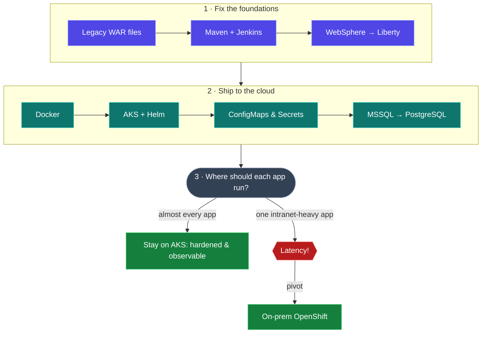
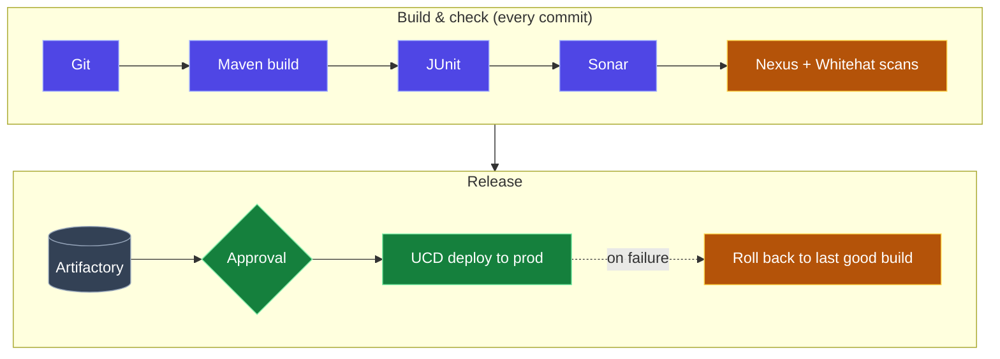
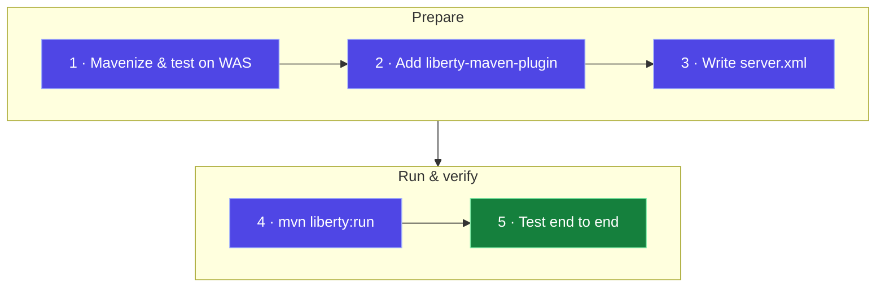
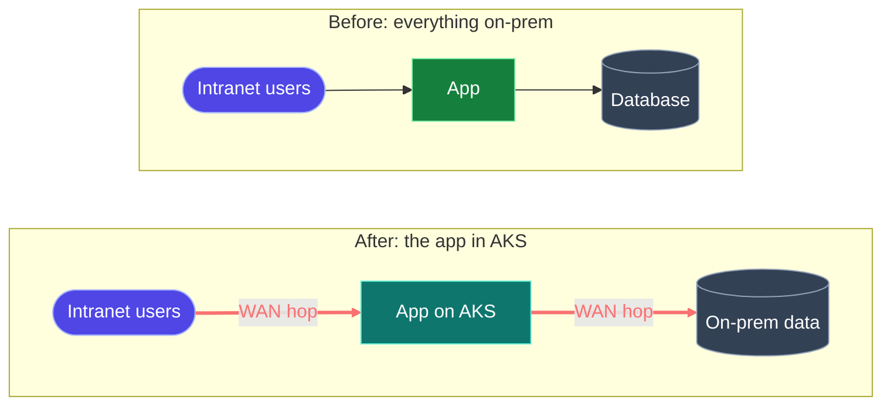
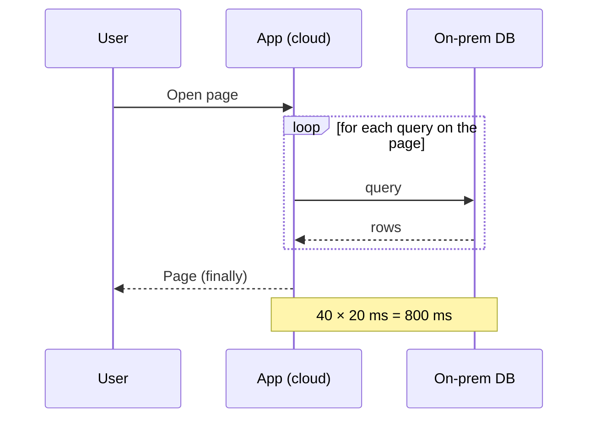
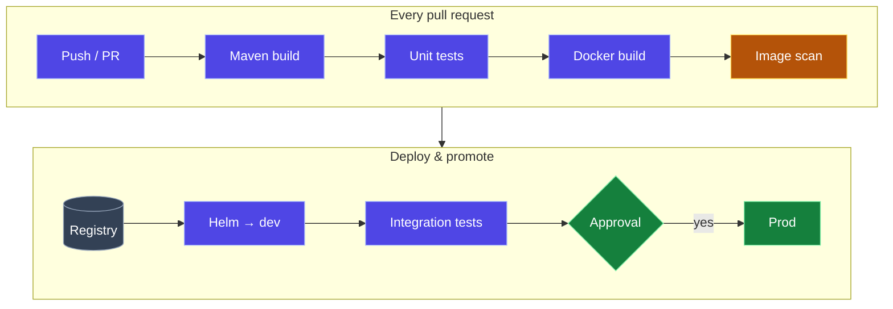
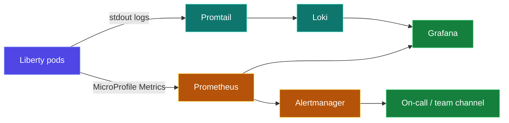
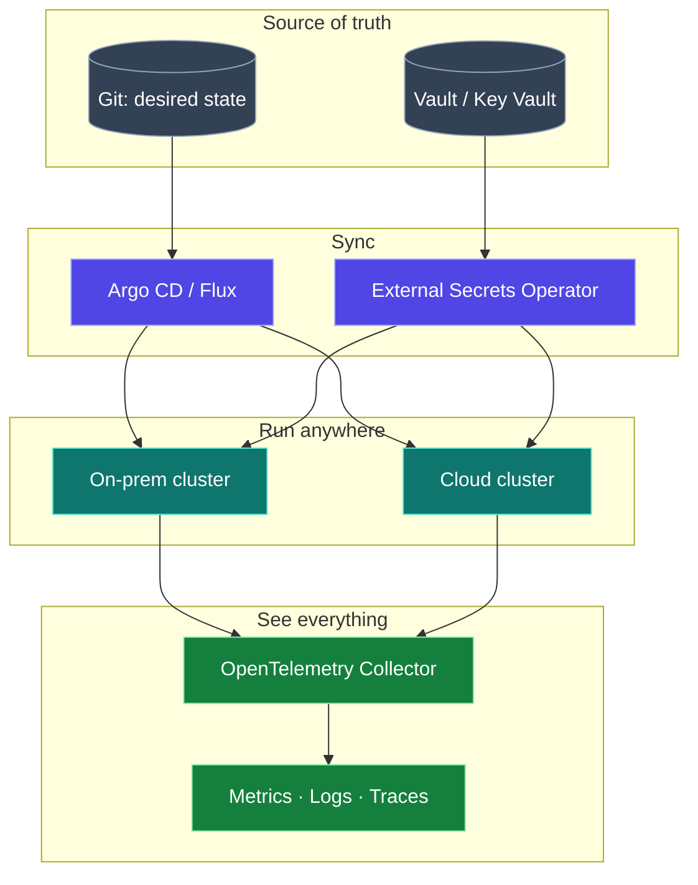

"Modernize or perish" isn't just a slogan. At some companies it's a Monday standup topic. This is the story of how we took **60+ legacy Java applications** from hand-built WAR files on WebSphere to Maven, Jenkins, Open Liberty, Docker and finally **Azure Kubernetes Service (AKS)**. Almost all of them still run in the cloud today. One didn't, and that one taught us the most.

If I had to sum up the work in one sentence: **we Googled a lot of YAML errors.**

<div class="stat-strip">
  <div><b>60+</b><span>legacy apps modernized</span></div>
  <div><b>~$800</b><span>per month in DB licensing saved</span></div>
  <div><b>Java 8 → 17</b><span>after leaving WebSphere</span></div>
  <div><b>1</b><span>app that had to come back on-prem</span></div>
</div>

## The route we planned vs. the route we took

Most cloud migration playbooks follow the same five stages. Think of them as the five stages of grief, for infrastructure:

1. **Assess**: "How bad is it, really?"
2. **Mobilize**: "Okay, it's bad. Let's plan."
3. **Migrate**: "Why did we agree to this?"
4. **Modernize**: "Oh wait, this is actually better."
5. **Optimize**: "We saved *how* much?"

Here's what our journey actually looked like, detours included:



## Where we started

Many of our critical applications were more than a decade old. They had to be available around the clock, and they had **no build tool, no CI/CD, no automated tests and no code scanning**. Deployments failed because of missing runtime components, missing config or missing source. Fixes for performance problems and vulnerable libraries were all manual.

Then came the big library scares (Equifax, Log4j 1.x). Upgrading a dependency across dozens of apps with no build system was slow and painful. That pain is what started the whole journey.

## Phase 1: Mavenization and a real pipeline

Every great journey starts with a single `pom.xml`.

Our builds could charitably be called "artisanal": custom scripts, JARs dropped into `/lib` by hand, and tribal knowledge that lived in exactly one senior developer's head. We moved every app to **Maven**, committed it to **Git**, and built **one reusable Jenkins pipeline** that any app could plug into:



What that gave us:

- **One project layout** everywhere, so no more "where's the source folder?" archaeology.
- **Managed dependencies**, so patching a vulnerable library became a one-line change plus a rebuild.
- **Quality and security gates**: Sonar for code quality, and Nexus plus Whitehat static and dynamic scans for vulnerable code and libraries.
- **Versioned artifacts in Artifactory**, which gave us a real **rollback** step for the first time.

Across **60+ applications**, this cut build and deploy times and sharply reduced post-deployment failures from missing components, bad config and duplicate code. It wasn't glamorous, but nothing else could happen until it was done.

## Phase 2: WebSphere to Open Liberty

With Maven in place, we could finally leave traditional **WebSphere Application Server (WAS)**. There were three reasons:

1. **Java 8 was the ceiling.** Even the latest WAS release supports only Java 8. **Liberty runs Java 17.**
2. **WAS doesn't fit Kubernetes.** On Azure, traditional WAS runs on VMs only, not on AKS, so it blocked everything we wanted to do next.
3. **Liberty is lighter and cloud-ready.** It starts in seconds, loads only the features you list, and doesn't need a Deployment Manager (NDM) server.

The migration itself is very repeatable once the app builds with Maven:



<details>
<summary>Step by step: the Maven plugin, server.xml and run commands</summary>

**1. Add the Liberty Maven plugin** to `pom.xml`:

```xml
<plugin>
  <groupId>io.openliberty.tools</groupId>
  <artifactId>liberty-maven-plugin</artifactId>
  <version>3.5.1</version>
  <configuration>
    <serverName>${serverName}</serverName>
    <configFile>${basedir}/src/main/liberty/config/server.xml</configFile>
    <bootstrapProperties>
      <default.http.port>${testServerHttpPort}</default.http.port>
      <default.https.port>${testServerHttpsPort}</default.https.port>
    </bootstrapProperties>
    <include>${packaging.type}</include>
  </configuration>
</plugin>
```

```xml
<properties>
  <app.name>${project.name}</app.name>
  <testServerHttpPort>8091</testServerHttpPort>
  <testServerHttpsPort>9445</testServerHttpsPort>
  <packaging.type>usr</packaging.type>
  <serverName>${app.name}Server</serverName>
</properties>
```

**2. Create `src/main/liberty/config/server.xml`.** Enable only the features the app uses. This version connects to SQL Server and reads credentials from environment variables instead of hard-coding them (more on that in Phase 5):

```xml
<server description="appName">
  <featureManager>
    <feature>servlet-3.1</feature>
    <feature>jsp-2.3</feature>
    <feature>jndi-1.0</feature>
    <feature>jdbc-4.0</feature>
  </featureManager>

  <httpEndpoint id="defaultHttpEndpoint" host="*"
      httpPort="${default.http.port}" httpsPort="${default.https.port}" />

  <library id="jdbcLib">
    <file name="/lib/mssql-jdbc.jar" />
  </library>

  <dataSource id="appDS" jndiName="jdbc/app_db">
    <jdbcDriver libraryRef="jdbcLib" />
    <properties.microsoft.sqlserver
        serverName="${env.DB_HOST}" portNumber="${env.DB_PORT}"
        databaseName="${env.DB_NAME}"
        user="${env.DB_USER}" password="${env.DB_PASSWORD}" />
  </dataSource>

  <webApplication id="app" location="app.war" contextRoot="/app" />
</server>
```

For a Spring Boot app with no datasource, the feature list can be just `servlet`, `jsp` and `jndi`.

**3. Run and test locally:**

```terminal
$ mvn clean install liberty:run
$ mvn liberty:stop
```

</details>

> [!TIP]
> Mavenize first and test the app end to end on the *old* server before touching Liberty. Then if something breaks, you know whether the build or the runtime caused it. For more detail, see my [guide to migrating from WAS to Liberty](https://medium.com/@mohiadeen-ameer/guide-to-migrate-java-applications-from-was-to-liberty-129cfff9d31d).

## Phase 3: Docker enters the chat

With Liberty in place, we containerized everything. The same image now ran in dev, staging and production. (Fewer surprises. Not *zero*. Let's be honest.)

```dockerfile
FROM open-liberty:kernel-slim-java17
COPY --chown=1001:0 server.xml /config/
COPY --chown=1001:0 target/*.war /config/apps/
RUN configure.sh
```

What we had to get right:

- **Base image choice**: full vs. `kernel-slim` Liberty, app by app.
- **Layer order**, to get the most out of the build cache.
- **Image scanning** in the pipeline, so known CVEs never reached production.
- **Developer buy-in**: Docker is an investment, not a tax.

> [!TIP]
> Your first `docker build` will fail. So will your second. By the fifteenth you'll be a pro.

## Phase 4: Kubernetes on AKS

Docker gives you containers. Kubernetes lets you run hundreds of them without losing your mind. We picked **AKS** for horizontal scaling, self-healing pods, declarative config, and the Helm ecosystem.

```yaml
apiVersion: apps/v1
kind: Deployment
metadata:
  name: my-legacy-app-thats-now-cool
spec:
  replicas: 3
  strategy:
    rollingUpdate: { maxSurge: 1, maxUnavailable: 0 }
  selector:
    matchLabels: { app: legacy-but-modern }
  template:
    metadata:
      labels: { app: legacy-but-modern }
    spec:
      containers:
      - name: app
        image: myregistry.azurecr.io/my-app:1.4.2
        ports: [{ containerPort: 9080 }]
        resources:
          requests: { memory: "256Mi", cpu: "250m" }
          limits:   { memory: "512Mi", cpu: "500m" }
        readinessProbe:
          httpGet: { path: /health/ready, port: 9080 }
          initialDelaySeconds: 10
        livenessProbe:
          httpGet: { path: /health/live, port: 9080 }
          initialDelaySeconds: 30
```

Three things in that manifest earned their place the hard way:

- **`resources`** stop one pod from eating a whole node (ask me how we learned that).
- **Readiness and liveness probes** tell Kubernetes the difference between "ready" and "stuck contemplating a `ClassNotFoundException`".
- **`maxSurge: 1, maxUnavailable: 0`** gives zero-downtime rollouts. No user should see a 503 because you pushed a config change.

We templated everything with **Helm**, so dev, staging and prod shared one chart instead of three copies of the YAML.

## Phase 5: Getting secrets out of the WAR file

Before Kubernetes, database passwords, API keys and service URLs lived in property files and `server.xml` inside the app. Changing one meant rebuilding and redeploying.

With **ConfigMaps** and **Secrets** injected as environment variables (the same `${env.DB_PASSWORD}` that Liberty reads above), config changes no longer needed a rebuild, and **RBAC** controlled who could read production credentials.

> [!WARNING]
> Base64 is **not** encryption. A security audit politely showed us that decoding our "encrypted" Kubernetes Secrets took exactly one terminal command. Back Secrets with a real secrets manager (Azure Key Vault, HashiCorp Vault or OpenBao) and turn on encryption at rest for etcd.

## Phase 6: MSSQL to PostgreSQL, saving real money

SQL Server Standard with core-based licensing was costing us about **$800 a month**. PostgreSQL's license is permissive, like BSD/MIT: no per-core fees, no CALs, and no surprise true-ups.

"Zero license cost" isn't zero cost. A managed PostgreSQL service still charges for compute, storage, backups and HA. The savings come from removing the licensing layer, and they were still large.

| From (T-SQL) | To (PostgreSQL) |
|---|---|
| `SELECT TOP 10 …` | `… LIMIT 10` |
| `ISNULL(a, b)` | `COALESCE(a, b)` |
| `GETDATE()` | `now()` |
| Stored procs in T-SQL | PL/pgSQL (mostly easy, sometimes painful) |

We moved the data with checksum validation, then ran `EXPLAIN ANALYZE` until our eyes glazed over, because PostgreSQL's query planner behaves differently from SQL Server's.

The savings were immediate. And then things got interesting.

## The plot twist: latency strikes back

Most of the apps were happy in AKS. One was not. It was built for **intranet** users: people on the corporate network, using it all day and talking to on-prem data. On-prem, it was fast and nobody complained.

After the move to AKS, every request from those users had to cross from the corporate network into Azure and back. Users noticed. Pages that felt instant now lagged, and when you use an app dozens of times a day, small delays add up to a miserable experience.



Why a "small" network hop hurts legacy apps so much: they're **chatty**. One page can make dozens of sequential calls, and each one pays the round-trip cost again.



We had modernized that app beautifully, and then got bottlenecked by physics. No code optimization makes light travel across a WAN faster.

```quiz
{
  "q": "A legacy page makes 40 sequential DB calls. Moving the app to the cloud adds 20 ms to each round trip. Roughly how much slower does the page get?",
  "options": ["About 20 ms", "About 200 ms", "About 800 ms"],
  "answer": 2,
  "why": "Each sequential call pays the extra round trip again: 40 × 20 ms ≈ 800 ms. That's why chatty apps suffer most when the network moves under them."
}
```

## The pivot: one app to on-prem OpenShift

Instead of fighting physics, we moved **just that app** to **Red Hat OpenShift on internal infrastructure**. Everything else stayed in AKS:

- **No more WAN hop.** The app went back to where its users and data were.
- **Kubernetes all the way down**, so its manifests, Helm charts and pipeline moved over with few changes. It was a lift-and-shift, not a rewrite.
- **OperatorHub** made certificate lifecycle easy: install the cert-manager operator, configure the Venafi issuer, and certificates renewed themselves.
- **Enterprise support** gave leadership the confidence to approve the pivot.

> [!NOTE]
> This is more common than it sounds. "Cloud repatriation" and hybrid platforms are a real trend now. Teams are learning that *Kubernetes* is the portable layer, not any particular cloud. Because we'd invested in Kubernetes rather than in AKS-specific services, moving that one app took weeks instead of a rewrite, and the rest of the estate didn't have to change at all.

**Not every app belongs in the same place. The plan is a starting point, not a contract.**

## The unglamorous parts: CI/CD, observability, security

Most migration posts show the shiny cluster and skip the plumbing that keeps it running. Here's ours.

### CI/CD for containers

The Jenkins pipeline from Phase 1 grew container stages:



Every PR deployed to its own dev namespace. Promotion to staging and prod went through manual approval gates, because nobody wants to auto-deploy a broken WAR on a Friday afternoon.

### Observability



- **Metrics**: JVM heap, p50/p95/p99 latency, error rates and pod resources.
- **Logs**: Loki indexes labels instead of full text, so it stays cheap. No more `kubectl logs` across 30 pods to find one stack trace.
- **Alerts**: if it pages someone at 3 AM, it had better be worth waking up for.

### Security hardening

- **RBAC**: developers could read prod, and only the pipeline could write.
- **Network policies**: deny-by-default between pods. This caught several "wait, why is Service A calling Service C?" moments.
- **Pod Security Standards**: no root, no privilege escalation, read-only root filesystems where possible.
- **Image provenance**: only scanned images from our private registry. No `random-image:latest` from Docker Hub in prod.

## If I did it again today

The fundamentals haven't changed, but the tooling has. Here's what I'd do differently today:



1. **Run a POC with real network paths before choosing a platform.** This one change would have caught our latency issue in weeks instead of months.
2. **GitOps from day one** with Argo CD or Flux. Git becomes the source of truth, and adding a second cluster (on-prem *and* cloud) is just another target.
3. **OpenTelemetry instead of per-tool agents.** Instrument once and send metrics, logs and traces to any backend. It's now the default way to do this.
4. **External Secrets Operator** to sync from Vault or Key Vault, so a base64 Secret is never the source of truth.
5. **Supply-chain security as standard**: generate an SBOM, sign images with Sigstore/cosign, and only admit signed images. It's the modern version of our Nexus and Whitehat gates.
6. **Use AI coding assistants for the boring parts** of a migration, like translating T-SQL, converting WAS config to `server.xml` and writing the first draft of Helm charts. Review everything, and let tests (not vibes) decide.
7. **FinOps from day one**: tag every workload and watch egress. Licensing savings can quietly turn into network bills.

## Lessons learned

- **Fix the build before the platform.** Maven and a real pipeline made every later step possible, including patching Log4j-style issues in hours instead of weeks.
- **Do POCs early.** End-to-end, with real users and real network paths.
- **Cost optimization ≠ performance optimization.** Users don't care about license savings if the app feels slow.
- **One size doesn't fit all.** Cloud was right for almost every app. For the one chatty, intranet-heavy app, on-prem OpenShift was right. Don't let a "everything goes to the cloud" rule force a bad fit.
- **Observability on day one**, not after the first outage.
- **Security is a constant, not a phase.** Scanning in CI, RBAC, network policies and real secrets management, from the start.

<details>
<summary>The whole journey on one screen (TL;DR)</summary>

Legacy WAR files → Maven and a reusable Jenkins pipeline (Sonar, Nexus, Whitehat, Artifactory, rollback) → WebSphere to Open Liberty (Java 17) → Docker → AKS with Helm → ConfigMaps, Secrets and Vault → MSSQL to PostgreSQL (saves about $800 a month) → Prometheus, Loki and Grafana → latency for one intranet-heavy app → **that app moves to on-prem OpenShift, the rest stay in AKS** → RBAC, network policies and image scanning → production-ready, fast and cheaper.

</details>

---

Cloud migration isn't a straight line. It's a GPS that keeps saying "recalculating" every time you think you've figured it out. Every detour taught us something, and the destination of modern, containerized, observable apps was worth the trip.

*Have you had to keep a workload on-prem, or fought a latency problem like this? I'd love to hear about it. Find me on [LinkedIn](https://www.linkedin.com/in/mohiadeen-ameer/).*
