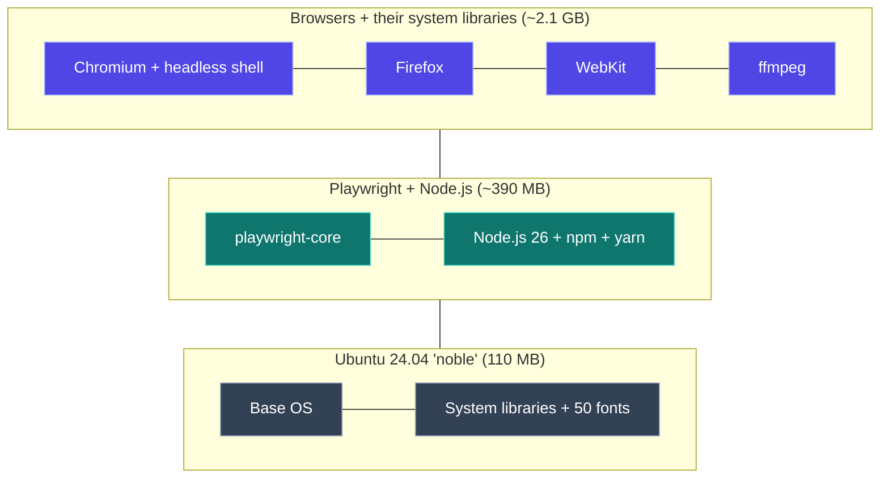
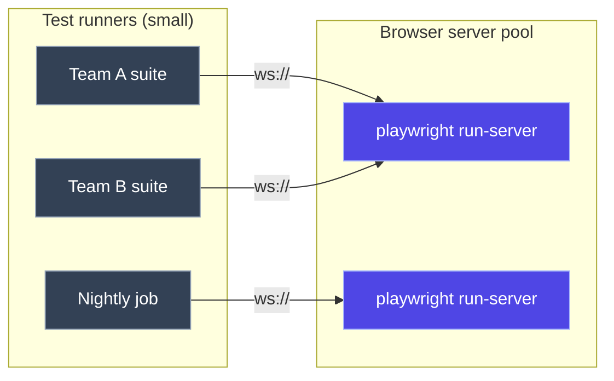
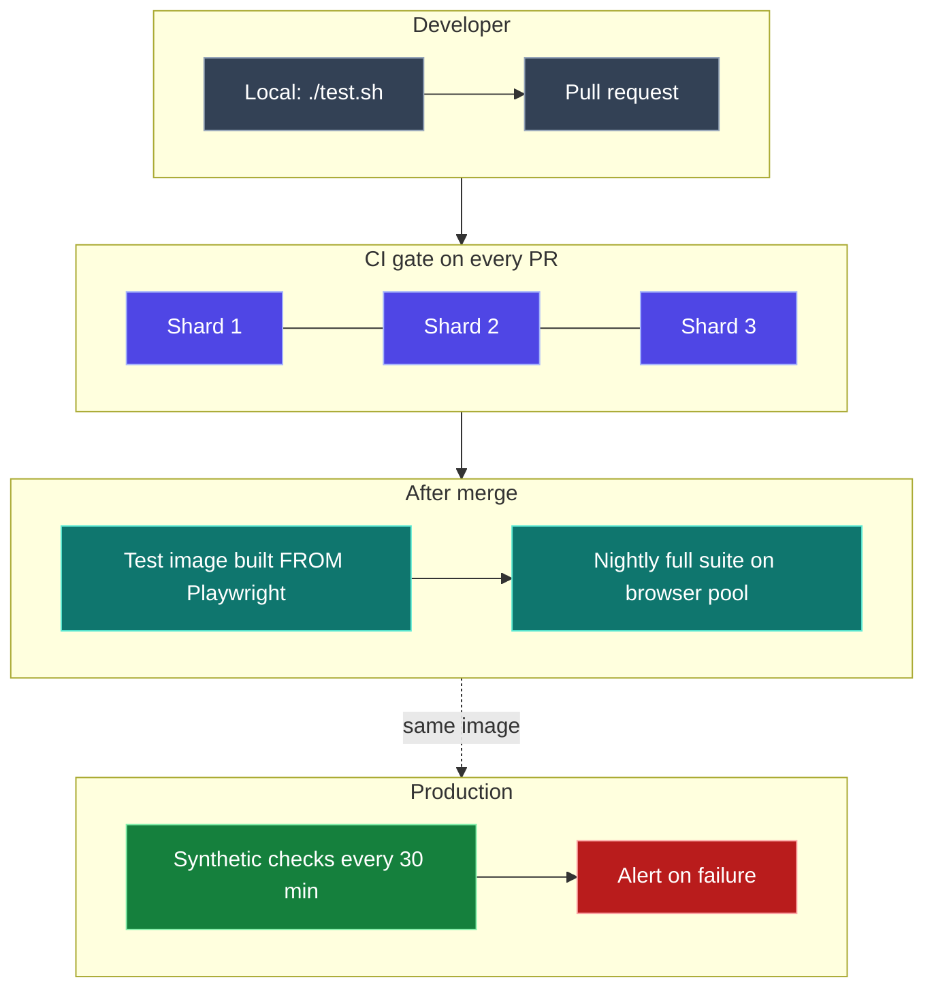
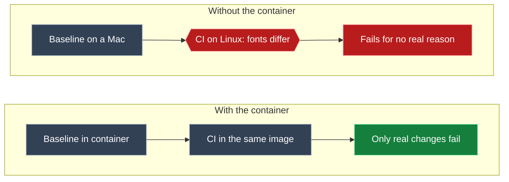

Before a demo this week, I asked my AI agent at the office to put together a slide deck with fresh screenshots of our app. In its log, I noticed it **pulled a container image from Microsoft**, `mcr.microsoft.com/playwright`, and took every screenshot from inside it.

That got me curious. What exactly is in that image? Why would an agent reach for it? And how do teams run it in real test automation systems, not just on a laptop? So I took it apart.

If I had to sum it up in one sentence: **it's a complete, version-locked browser lab in one image, and how you run it matters as much as what's in it.**

<div class="stat-strip">
  <div><b>~1 GB</b><span>download, 3.5 GB on disk</span></div>
  <div><b>3</b><span>browser engines: Chromium, Firefox, WebKit</span></div>
  <div><b>4</b><span>language flavors: Node, Python, .NET, Java</span></div>
  <div><b>2</b><span>CPU architectures: amd64 and arm64</span></div>
</div>

Everything below comes from inspecting and running the image myself. The runnable examples are in **[mohiadeen-ameer/playwright-container-demo](https://github.com/mohiadeen-ameer/playwright-container-demo)**.

## What it is, in one picture

[Playwright](https://playwright.dev) is Microsoft's open-source tool for driving real browsers from code. The hard part has never been the code; it's the **setup**. Each Playwright release needs specific browser builds, plus dozens of Linux libraries for graphics, audio, fonts and codecs. Get one wrong and you get `error while loading shared libraries`.

The container ships all of it, tested together:



## Where it lives, and how the tags work

The image is published on **Microsoft Container Registry (MCR)**, not Docker Hub. The tag tells you three things:

```
mcr.microsoft.com/playwright:v1.64.1-noble
                  │           │      │
                  │           │      └─ Ubuntu base
                  │           └──────── Playwright version
                  └──────────────────── flavor (language)
```

- **Flavor:** `playwright` (Node), `playwright/python`, `playwright/dotnet`, `playwright/java`
- **Version:** must match the Playwright version in your project, exactly
- **Base:** `jammy` (22.04), `noble` (24.04) or `resolute` (26.04)

What I found on the registry for this release:

| Image | Bases for v1.64.1 | Notes |
|---|---|---|
| `playwright` (Node) | jammy, noble, resolute | Also `-amd64` / `-arm64` and nightly `canary` tags |
| `playwright/python` | jammy, noble, resolute | For pytest-playwright suites |
| `playwright/dotnet` | noble, resolute | For NUnit / MSTest suites |
| `playwright/java` | noble | **Lags one patch behind**: latest was v1.64.0 |

Every tag is a **multi-arch manifest**, built for both `linux/amd64` and `linux/arm64`. On my Apple Silicon Mac it pulled the native arm64 build automatically; in GitHub Actions, the amd64 one.

> [!TIP]
> For production, pin the **digest**, not just the tag. A tag can be re-pushed; a digest can't:
> `mcr.microsoft.com/playwright:v1.64.1-noble@sha256:2f05f8a7…9038768f`

## Inside the image

### Configuration

```terminal
$ docker image inspect mcr.microsoft.com/playwright:v1.64.1-noble \
    --format 'User={{.Config.User}} Cmd={{.Config.Cmd}} Layers={{len .RootFS.Layers}}'
User= Cmd=[/bin/bash] Layers=7
$ docker image inspect mcr.microsoft.com/playwright:v1.64.1-noble \
    --format '{{range .Config.Env}}{{println .}}{{end}}'
LANG=C.UTF-8
LC_ALL=C.UTF-8
PLAYWRIGHT_BROWSERS_PATH=/ms-playwright
```

Three things worth knowing:

- **`User=` is empty, so it runs as root by default.** A non-root user, `pwuser` (uid 1001), is already created for you. Use it.
- **`PLAYWRIGHT_BROWSERS_PATH=/ms-playwright`** tells Playwright where the browsers are. This is why your project's `npm ci` doesn't download browsers again.
- **There's no entrypoint**, just `bash`. You decide what runs.

### What takes up the space

```terminal
$ docker run --rm mcr.microsoft.com/playwright:v1.64.1-noble \
    bash -c 'du -sh /ms-playwright/* /usr/share/fonts'
402M  /ms-playwright/chromium-1248
278M  /ms-playwright/chromium_headless_shell-1248
3.9M  /ms-playwright/ffmpeg-1013
287M  /ms-playwright/firefox-1555
277M  /ms-playwright/webkit-2370
91M   /usr/share/fonts
```

That's about **1.25 GB of browsers**. Chromium comes twice: the full browser, and a lighter **headless shell** that Playwright uses for headless runs. The registry download is **0.96 GB compressed in 7 layers**, which unpacks to 3.5 GB.

### The fonts are a feature

The image includes **50 font files**: Liberation (metric-compatible with Arial and Times), Noto Color Emoji, IPA Gothic (Japanese), WenQuanYi (Chinese) and more. Without them, screenshots of real-world pages show empty boxes instead of emoji or Asian text. Font differences are also a common cause of flaky visual tests, which comes up again below.

### Small extras

`python3`, `npm` 11 and `yarn` 1.22 are preinstalled, with 511 Debian packages in total. It's a full, comfortable Linux environment, not a stripped-down distroless image.

> [!NOTE]
> This is exactly why it suits **AI agents**. An agent shouldn't install browsers and system packages on your machine. With this image it pulls one artifact, does its browser work in a disposable sandbox, and leaves nothing behind. That's very likely why my office agent reached for it.

## Running it right: the flags that matter

```bash
docker run --rm --init --ipc=host --user pwuser \
  -v "$PWD":/work -w /work \
  mcr.microsoft.com/playwright:v1.64.1-noble \
  npx playwright test
```

| Flag | What it prevents |
|---|---|
| `--ipc=host` | Chromium crashing. It uses shared memory heavily, and Docker's default `/dev/shm` is only 64 MB. Playwright's docs recommend this flag. |
| `--init` | Zombie processes. Browsers spawn many child processes; `--init` adds a tiny init process as PID 1 to reap them and forward signals. |
| `--user pwuser` | Running browsers as root. Use it whenever the container visits sites you don't control. |
| `--rm` | Leftover containers piling up after every run. |
| `-v "$PWD":/work` | Copying files in and out. Your project mounts in; reports and screenshots land back on your disk. |

```quiz
{
  "q": "Your Chromium tests crash randomly in Docker on big pages, but never on your laptop. What's the most likely fix?",
  "options": ["Add more CPU to the container", "Run with --ipc=host (or a larger --shm-size)", "Switch the base from noble to jammy"],
  "answer": 1,
  "why": "Chromium uses shared memory heavily and Docker's default /dev/shm is only 64 MB. --ipc=host (recommended by Playwright) or a bigger --shm-size fixes it."
}
```

## Five ways to use it in practice

These go from a single command to a full production setup. I ran every one of them.

### 1. One-shot jobs: screenshots, PDFs, scraping

This is what my agent did: start the container, do browser work, exit. My demo takes 6 screenshots (desktop, phone, light and dark, WebKit, a live URL) and assembles them into a PDF slide deck with Playwright's own `page.pdf()`:

```terminal
$ ./shoot.sh
✓ 01-dashboard-light           chromium   997 ms
✓ 02-dashboard-dark            chromium   899 ms
✓ 03-release-details           chromium   969 ms
✓ 04-mobile                    chromium   943 ms
✓ 05-safari-webkit             webkit     961 ms
✓ 06-live-site                 chromium  1431 ms

6 screenshots + deck.pdf in /work/out (8.4 s)
```

<figure><figcaption>Captured inside the container: the script clicks a release first, then takes the screenshot</figcaption></figure>

<figure><figcaption>The same page rendered by WebKit, Safari's engine, on Linux</figcaption></figure>

### 2. Bake your tests into your own image

For production pipelines, don't mount code at runtime. **Build an image `FROM` Playwright's**, so every run is reproducible and fully versioned:

```dockerfile
FROM mcr.microsoft.com/playwright:v1.64.1-noble

WORKDIR /app

# Dependencies first, so this layer stays cached until package*.json changes
COPY package.json package-lock.json ./
RUN npm ci --no-audit --no-fund

# Then the tests (change often, cheap layer)
COPY . .
RUN chown -R pwuser:pwuser /app
USER pwuser

CMD ["npx", "playwright", "test"]
```

```terminal
$ docker build -t release-radar-tests .        # first build: 16 s
$ docker run --rm --ipc=host release-radar-tests
  18 passed (4.5s)
$ touch tests/release-radar.spec.ts && docker build -t release-radar-tests .
 => CACHED [4/6] RUN npm ci --no-audit --no-fund
                                               # rebuild after a test change: 1 s
```

What this gave me:
- **It only adds 57 MB** on top of the base image (3.60 GB vs 3.54 GB). The browsers are shared, not copied.
- **It runs as non-root** `pwuser` by default.
- **Layer order matters.** Because dependencies are installed before the tests are copied, changing a test rebuilds in **1 second**.

### 3. A shared browser server

Playwright can run **as a server**. Browsers live in one container, and tests in any other container connect over WebSocket. This lets many teams or pipelines share a pool of browsers, and keeps test runners small. With Docker Compose:

```yaml
services:
  browsers:
    image: mcr.microsoft.com/playwright:v1.64.1-noble
    user: pwuser
    working_dir: /home/pwuser
    init: true
    ipc: host
    command: ["npx", "-y", "playwright@1.64.1", "run-server", "--port", "3000", "--host", "0.0.0.0"]
    healthcheck:
      test: ["CMD", "bash", "-c", "echo > /dev/tcp/127.0.0.1/3000"]
      interval: 2s
      retries: 30

  tests:
    build: .
    depends_on:
      browsers:
        condition: service_healthy
    environment:
      PW_WS: ws://browsers:3000/
```

In the Playwright config, the tests switch to the remote browser when `PW_WS` is set. `exposeNetwork` lets the remote browser reach the app that's running inside the *test* container:

```typescript
use: {
  ...(process.env.PW_WS
    ? { connectOptions: { wsEndpoint: process.env.PW_WS, exposeNetwork: "<loopback>" } }
    : {}),
},
```

```terminal
$ docker compose up --build --abort-on-container-exit --exit-code-from tests
browsers-1  | Listening on ws://0.0.0.0:3000/
tests-1     |   ✓  4 [chromium] › lists every release with its status (345ms)
tests-1     |   ✓  1 [chromium] › dashboard looks right (light) (393ms)
tests-1     |   ✓  3 [chromium] › clicking a release opens its details, and × closes them (667ms)
tests-1     |   6 passed (1.5s)
```

Even the pixel-perfect visual tests passed through the remote browser, because it's the same image rendering the same pixels.



> [!WARNING]
> **Client and server versions must match exactly.** I pointed a 1.64 client at a 1.63 server to see what happens:
> ```
> WebSocket error: 428 Precondition Required
> Playwright version mismatch:
>   - server version: v1.63
>   - client version: v1.64
> ```
> When you upgrade Playwright, upgrade the server image and every client in the same change.

### 4. CI: the same image, in parallel shards

GitHub Actions can run a job **inside** the container, so CI uses the exact same environment as your laptop. Large suites split across machines with `--shard`:

```yaml
jobs:
  tests:
    runs-on: ubuntu-latest
    strategy:
      fail-fast: false
      matrix:
        shard: [1, 2, 3]
    container:
      image: mcr.microsoft.com/playwright:v1.64.1-noble
      options: --ipc=host
    steps:
      - uses: actions/checkout@v4
      - run: npm ci
      - run: npx playwright test --shard=${{ matrix.shard }}/3
      - uses: actions/upload-artifact@v4
        if: always()
        with:
          name: playwright-report-shard-${{ matrix.shard }}
          path: playwright-report/
```

On the demo repo, the three shards ran in parallel, each job taking 41–76 seconds including container start. The bigger finding came on the first push. The visual baselines were created on my **arm64 Mac**, and GitHub's **amd64 Linux** runners matched them pixel for pixel, with zero tolerance. Same image, same fonts, same pixels.

### 5. Synthetic monitoring of production

The same image can test **your live production site** on a schedule, the way a user would. If it fails, users are affected:

```typescript
test("a post opens and its diagrams render", async ({ page }) => {
  const errors: string[] = [];
  page.on("pageerror", e => errors.push(e.message));

  await page.goto(SITE);
  await page.locator(".card").first().click();
  await expect(page.locator("h1.post-title")).toBeVisible();
  await expect(page.locator("figure.diagram svg").first()).toBeVisible();
  expect(errors, "no JavaScript errors on the page").toEqual([]);
});
```

```yaml
on:
  schedule:
    - cron: "*/30 * * * *"   # every 30 minutes
```

I pointed it at this blog, on desktop and phone:

```terminal
$ npx playwright test -c playwright.synthetic.config.ts
home page ready in 380 ms
  ✓  1 [desktop] › home page loads fast and lists posts (456ms)
  ✓  2 [phone] › home page loads fast and lists posts (730ms)
  ✓  3 [desktop] › a post opens and its diagrams render (1.5s)
  ✓  4 [phone] › a post opens and its diagrams render (3.2s)
  ✓  5 [desktop] › About page has working contact links (581ms)
  ✓  6 [phone] › About page has working contact links (595ms)
  6 passed (6.1s)
```

Unlike a simple uptime ping, this catches broken JavaScript, missing content and slow pages: the problems a status check reports as "200 OK".

## Putting it together: a test automation system

Here's how these patterns combine in a real system. Every box runs the same pinned image:



### Why visual tests need the container

Visual regression tests compare screenshots pixel by pixel against an approved baseline. They're famous for flakiness, and the cause is usually **the environment, not the app**: different fonts, font smoothing or GPU settings between a developer's Mac and a Linux CI server.



To prove the container makes them trustworthy, I made a "tiny" CSS change: the dashboard's KPI numbers went from `28px` to `24px`. Every **functional** test still passed, because the app worked. The **visual** tests caught it immediately:

```terminal
$ ./test.sh --project=chromium
  ✓  4 [chromium] › lists every release with its status (282ms)
  ✓  5 [chromium] › clicking a release opens its details, and × closes them (641ms)
  ✘  2 [chromium] › dashboard looks right (light) (682ms)
  ✘  1 [chromium] › dashboard looks right (dark) (714ms)

    Error: expect(page).toHaveScreenshot(expected) failed
      14607 pixels (ratio 0.02 of all image pixels) are different.
```

<figure><figcaption>Playwright's diff image: every changed pixel in red</figcaption></figure>

<figure><figcaption>The HTML report: 4 passed, 2 failed, with diffs and traces attached</figcaption></figure>

## Gotchas

- **Version lock, two ways.** The image tag must match the `playwright` npm version in your project (otherwise it looks for browser builds that aren't there), and a browser server must match its clients (the `428` error above). Upgrade everything in one change.
- **Size.** About 1 GB to download and 3.5 GB on disk. On CI, use runners that cache images, and don't pull a new tag on every job.
- **Root by default.** Add `--user pwuser`, or `USER pwuser` in your Dockerfile, whenever you visit sites you don't control.
- **Create visual baselines inside the container**, never on your host OS directly.
- **The first visual run "fails"** with `A snapshot doesn't exist … writing actual`. Create baselines on purpose with `--update-snapshots`, review them, and commit them.
- **Language images can lag.** The Java image was one patch behind the Node one when I checked.

## Production checklist

1. Pin the image **by digest**, and upgrade it like any dependency: in a pull request, with a test run.
2. Keep the image tag, the npm version and any browser servers on **the same Playwright version**.
3. Run with `--init --ipc=host`, and as **`pwuser`**.
4. **Bake tests into an image** for repeatable pipelines; mount code only for local development.
5. **Shard** big suites, and upload reports and traces as artifacts (`trace: "retain-on-failure"`).
6. Add **synthetic checks** against production, with retries to ignore one-off network blips.
7. Keep visual tests to the **pages that matter**; a few stable screenshots beat hundreds of noisy ones.

## Lessons learned

- **The setup is the product.** The image's real value is a tested, version-locked match of browsers, libraries and fonts.
- **How you run it matters.** `--ipc=host`, `--init` and `pwuser` prevent the crashes and risks people blame on Playwright.
- **One image, many roles.** The same artifact serves as a laptop tool, a CI job, a browser server and a production monitor.
- **Same image means trustworthy pixels.** Baselines from an arm64 Mac matched amd64 CI exactly.
- **Watch what your agents do.** I found this tool by reading my agent's log.

<details>
<summary>The whole thing on one screen (TL;DR)</summary>

`mcr.microsoft.com/playwright:v1.64.1-noble` is Microsoft's browser image: Ubuntu 24.04, Node.js 26, Chromium, Firefox and WebKit (about 1.25 GB of browsers), 50 fonts, and a `pwuser` account. It's about 1 GB to download and 3.5 GB on disk, multi-arch, with Python, .NET and Java flavors.

Run it with `--init --ipc=host --user pwuser`, and pin it by digest. Then use it five ways:

1. one-shot jobs
2. your own test image (+57 MB, 1-second rebuilds)
3. a shared browser server via Compose
4. sharded CI
5. synthetic monitoring of production

Keep every Playwright version in lockstep.

</details>

---

What started as a line in my agent's log turned into a new respect for a well-built container image: the hard, boring setup work done once, so every laptop, pipeline and monitor gets exactly the same browsers.

*Are you running Playwright in containers in production? I'd love to hear how you've set it up. Find me on [LinkedIn](https://www.linkedin.com/in/mohiadeen-ameer/).*
