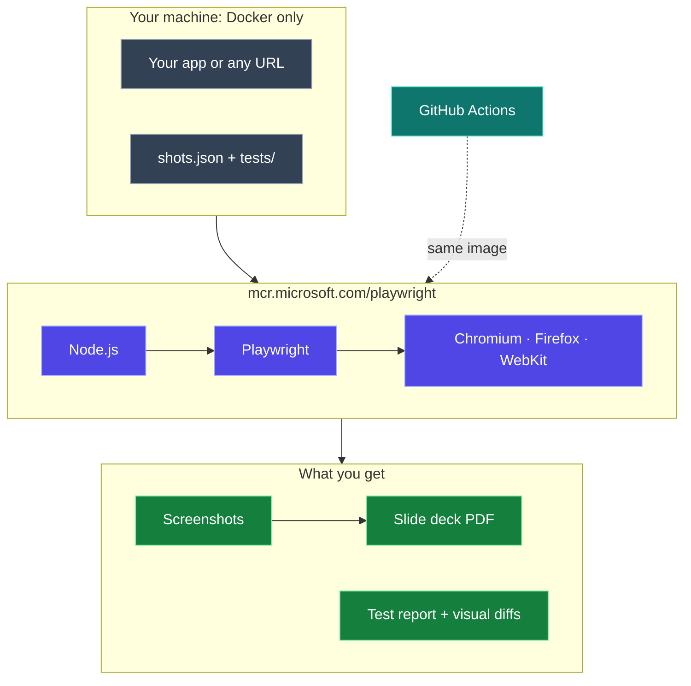
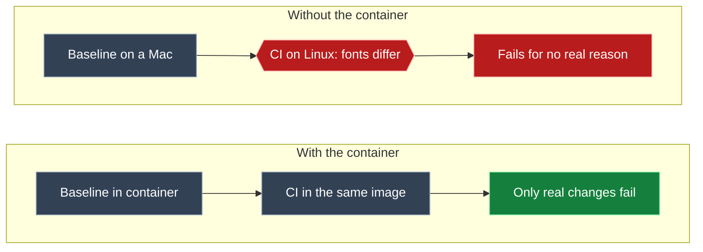
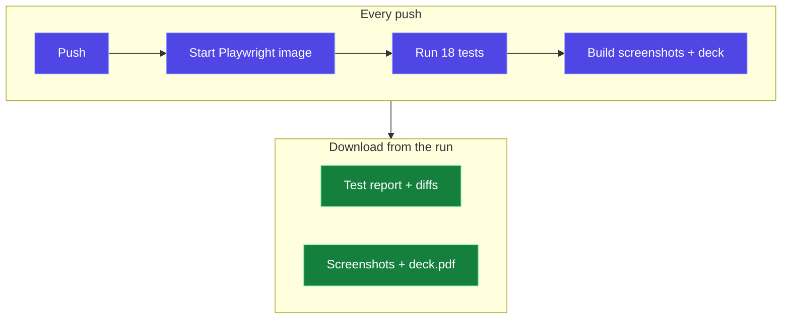

Today I had a demo. Before it, I asked my AI agent at the office to put together a slide deck with fresh screenshots of the app. While it worked, I noticed something in its log: it **pulled a container image from Microsoft**, `mcr.microsoft.com/playwright`, and used that to take the screenshots.

I'd used Playwright before, but never thought about running it in a container. So after the demo I rebuilt the idea from scratch: a small app, a script that turns screenshots into slides, and a proper test suite, all running in that container. **My Mac has Docker and nothing else**: no Node.js, no browsers.

If I had to sum it up in one sentence: **one `docker run` gives you three real browsers, ready to screenshot, test and export, on any machine.**

<div class="stat-strip">
  <div><b>0</b><span>Node or browser installs on my Mac</span></div>
  <div><b>3</b><span>browser engines in one image</span></div>
  <div><b>&lt;10 s</b><span>for 6 screenshots + a 7-slide PDF</span></div>
  <div><b>18</b><span>tests across 3 browsers in 4.8 s</span></div>
</div>

The demo code is on GitHub: **[mohiadeen-ameer/playwright-container-demo](https://github.com/mohiadeen-ameer/playwright-container-demo)**. Everything in this post, including every number and screenshot, comes from running it.

## The big picture



## What the Playwright container is

[Playwright](https://playwright.dev) is Microsoft's open-source tool for driving real browsers from code: open a page, click, type, take screenshots, run tests. The hard part is never the code. It's the **setup**: Playwright needs specific browser builds plus dozens of Linux system libraries (fonts, graphics, audio, codecs) that have to match exactly.

Microsoft solves that with an official Docker image that has everything preinstalled and version-matched. Here's what I found inside:

```terminal
$ docker pull mcr.microsoft.com/playwright:v1.64.1-noble
$ docker run --rm mcr.microsoft.com/playwright:v1.64.1-noble \
    bash -c 'node --version; ls /ms-playwright; grep PRETTY /etc/os-release'
v26.13.0
chromium-1248
chromium_headless_shell-1248
ffmpeg-1013
firefox-1555
webkit-2370
PRETTY_NAME="Ubuntu 24.04.5 LTS"
```

| Inside the image | Why it matters |
|---|---|
| Ubuntu 24.04 ("noble") | A stable, known Linux base |
| Node.js 26 | Run Playwright scripts and tests without installing Node yourself |
| Chromium, Firefox, **WebKit** | All three engines. WebKit is Safari's engine, so you can check Safari rendering from Linux |
| ffmpeg | Video recording of test runs |
| All system libraries and fonts | No "missing libnss3.so" errors, ever |

The pull took **31 seconds** on my connection, and the image is about **3.5 GB** on disk. That's big, but you download it once.

> [!NOTE]
> This is why the image is so useful for **AI agents**. An agent can't (and shouldn't) install browsers and system packages on your machine. With the container, it pulls one image, does its browser work inside a disposable sandbox, and leaves your machine untouched. That's very likely why my office agent reached for it.

## Step 1: A small app to capture

I built a tiny dashboard called **Release Radar** to have something realistic to photograph: delivery metrics, a deploys chart, a releases table, and a details panel that opens when you click a release. It supports light and dark mode, because real demos need both.

<div class="fig-pair">
<figure><figcaption>Light mode</figcaption></figure>
<figure><figcaption>Dark mode</figcaption></figure>
</div>

Every screenshot in this post was taken by the container, not by me.

## Step 2: Screenshots as code

Instead of clicking around and pressing ⌘⇧4 before every demo, the screenshots are described in a file. Each entry is one screenshot, and later one slide:

```json
{
  "name": "03-release-details",
  "title": "Release details panel",
  "url": "/",
  "viewport": "desktop",
  "colorScheme": "dark",
  "click": "tr[data-release='3.0.0']",
  "waitFor": ".panel.open"
}
```

You can set the page, screen size (`desktop`, `tablet`, `mobile`), light or dark mode, browser engine, and even **click something first**, like opening a panel, before the photo is taken. The core of `shoot.mjs` is only a few lines of Playwright:

```javascript
const context = await browser.newContext({ ...device, colorScheme: shot.colorScheme });
const page = await context.newPage();

await page.goto(url, { waitUntil: "networkidle" });
if (shot.click) await page.click(shot.click);          // e.g. open the details panel
if (shot.waitFor) await page.waitForSelector(shot.waitFor);
await page.screenshot({ path: file, fullPage: !!shot.fullPage });
```

And the whole thing runs with one command. `shoot.sh` is just a `docker run` that mounts the project folder into the container:

```bash
docker run --rm --init --ipc=host \
  -v "$PWD":/work -w /work \
  mcr.microsoft.com/playwright:v1.64.1-noble \
  bash -c "npm ci && node shoot.mjs"
```

```terminal
$ ./shoot.sh
added 2 packages in 441ms
✓ 01-dashboard-light           chromium   997 ms
✓ 02-dashboard-dark            chromium   899 ms
✓ 03-release-details           chromium   969 ms
✓ 04-mobile                    chromium   943 ms
✓ 05-safari-webkit             webkit     961 ms
✓ 06-live-site                 chromium  1431 ms

6 screenshots + deck.pdf in /work/out (8.4 s)
```

**Under 10 seconds** from command to finished screenshots and deck. Here's what came out:

<figure><figcaption>Clicked into the "inventory" release first, then captured. No human involved.</figcaption></figure>

<figure><figcaption>Same page rendered by WebKit (Safari's engine), on Linux</figcaption></figure>

<figure class="narrow"><figcaption>Phone size, full scrolling page</figcaption></figure>

It isn't limited to your own app. Any URL works. Here it is capturing this blog:

<figure><figcaption>A live website, captured from inside the container</figcaption></figure>

> [!TIP]
> `--ipc=host` matters. Chromium uses shared memory heavily, and Docker's default 64 MB can make it crash on big pages. Playwright's own docs recommend this flag.

## Step 3: From screenshots to slides

This is the part my office agent did for the demo: screenshots into a presentation. The demo does it with **Playwright itself**, with no extra libraries:

1. Build a simple HTML page where each "slide" is exactly 16:9 and holds one screenshot with its title.
2. Open that page in Chromium inside the container.
3. Call `page.pdf()` to print it as a landscape PDF, one slide per page.

```javascript
await deckPage.setContent(deckHtml, { waitUntil: "load" });
await deckPage.pdf({ path: "out/deck.pdf", width: "13.333in", height: "7.5in", printBackground: true });
```

<div class="fig-pair">
<figure><figcaption>Slide 1: generated title slide</figcaption></figure>
<figure><figcaption>Every screenshot becomes a labeled slide</figcaption></figure>
</div>

The result is a 7-page PDF: a title slide plus one slide per screenshot. It opens anywhere and presents full-screen like any deck. If you need an editable PowerPoint file, the same screenshots can go into a library like `pptxgenjs`, but for a demo, the PDF was all I needed.

```quiz
{
  "q": "Why does the demo run `npm ci` inside the container instead of on the Mac?",
  "options": ["The Mac's npm is too old", "There's no Node on the Mac at all; the container brings its own", "npm doesn't work with Docker volumes"],
  "answer": 1,
  "why": "The whole point: the host only needs Docker. Node.js 26, npm and the browsers all live in the image."
}
```

## Step 4: Test automation with the container

Screenshots for slides are nice. **Tests are where the container really earns its keep.** The demo includes a Playwright Test suite with two kinds of tests.

### Functional tests: does the app work?

These click around like a user and check what happens:

```typescript
test("clicking a release opens its details, and × closes them", async ({ page }) => {
  const panel = page.locator("#panel");
  await expect(panel).toBeHidden();

  await page.getByRole("cell", { name: "inventory" }).click();
  await expect(panel).toBeVisible();
  await expect(panel).toContainText("lock contention under load");

  await page.getByRole("button", { name: "Close" }).click();
  await expect(panel).toBeHidden();
});
```

### Visual regression tests: does it still look right?

These compare the page, pixel by pixel, against an approved "golden" screenshot:

```typescript
test("dashboard looks right (dark)", async ({ page }) => {
  await page.emulateMedia({ colorScheme: "dark" });
  await expect(page).toHaveScreenshot("dashboard-dark.png", { fullPage: true });
});
```

The config runs every test in **three browsers**:

```typescript
projects: [
  { name: "chromium", use: { ...devices["Desktop Chrome"] } },
  { name: "webkit",   use: { ...devices["Desktop Safari"] } },
  { name: "mobile",   use: { ...devices["Pixel 7"] } },
],
```

```terminal
$ ./test.sh
Running 18 tests using 5 workers
  ✓   1 [chromium] › lists every release with its status (321ms)
  ✓   2 [chromium] › clicking a release opens its details, and × closes them (669ms)
  ✓   8 [webkit] › clicking a release opens its details, and × closes them (2.1s)
  ✓  12 [webkit] › details panel looks right (1.3s)
  ✓  18 [mobile] › details panel looks right (259ms)
  ...
  18 passed (4.8s)
```

6 tests × 3 browsers = **18 tests in under 5 seconds**.

### Why visual tests need the container

Visual tests are famous for being flaky, and the reason is usually **not your app**. The same page renders slightly differently on different machines: different fonts, font smoothing and GPU settings. A screenshot approved on a Mac won't match one taken on a Linux CI server, so the test fails even though nothing changed.



With the container, your laptop and CI use **the exact same image**, so the same fonts and the same pixels. That's why the demo can use `maxDiffPixels: 0`, which means not a single pixel of tolerance.

### Catching a real regression

To prove it works, I made the kind of "tiny" CSS change that slips through code review: the KPI numbers went from `28px` to `24px`. Nothing broke functionally. Then I ran the tests:

```terminal
$ ./test.sh --project=chromium
  ✓  4 [chromium] › lists every release with its status (282ms)
  ✓  3 [chromium] › shows the four delivery metrics (323ms)
  ✓  5 [chromium] › clicking a release opens its details, and × closes them (641ms)
  ✘  2 [chromium] › dashboard looks right (light) (682ms)
  ✘  1 [chromium] › dashboard looks right (dark) (714ms)

    Error: expect(page).toHaveScreenshot(expected) failed
      14607 pixels (ratio 0.02 of all image pixels) are different.
```

The **functional tests passed**, because the app still works. The **visual tests failed**, because it no longer looks the same. Playwright writes a diff image that highlights every changed pixel in red:

<figure><figcaption>The diff: every pixel that moved is highlighted. The smaller numbers shifted the whole layout.</figcaption></figure>

And the HTML report shows exactly what failed, with the screenshots and a trace you can step through:

<figure><figcaption>Playwright's HTML report: 4 passed, 2 failed, with image diffs and traces attached</figcaption></figure>

If the change was intentional, you accept it as the new baseline with one command (inside the container, so the pixels stay consistent):

```terminal
$ ./test.sh --update-snapshots
```

## Step 5: The same container in CI

GitHub Actions can run a job **inside** a container image, so CI uses the exact same environment as your laptop. Trimmed from the demo's workflow:

```yaml
jobs:
  test-and-screenshots:
    runs-on: ubuntu-latest
    container:
      image: mcr.microsoft.com/playwright:v1.64.1-noble
      options: --ipc=host
    steps:
      - uses: actions/checkout@v4
      - run: npm ci
      - run: npx playwright test
      - run: node shoot.mjs
      - uses: actions/upload-artifact@v4
        with: { name: screenshots-and-deck, path: out/ }
```



Every push now produces a test report **and** a fresh slide deck, ready to download for the next demo.

**The real proof came on the first push.** The visual baselines were created in Docker on my Mac. GitHub's servers run Linux on completely different hardware. The [very first CI run](https://github.com/mohiadeen-ameer/playwright-container-demo/actions) still passed all 18 tests, including the pixel-perfect visual tests with zero tolerance, in about a minute end to end. Same image, same pixels.

## Gotchas I hit

> [!WARNING]
> **The image tag and the npm version must match exactly.** The image `v1.64.1` contains browser builds for Playwright `1.64.1`. If `package.json` says anything else, Playwright looks for browsers that aren't there and fails. Pin both, and update them together.

- **The first visual test run "fails".** No baseline exists yet, so Playwright writes one and reports `A snapshot doesn't exist … writing actual`. Create baselines deliberately with `--update-snapshots`, look at them, and commit them.
- **Never create baselines on your Mac directly.** Always do it in the container, or CI won't match.
- **3.5 GB is a lot for a laptop.** On CI, cache the image or use a runner that already has it, so you don't pull it on every job.
- **It runs as root by default.** That's fine for your own app. For **untrusted websites**, run as the built-in `pwuser` user and follow Playwright's Docker security guidance.

## If I set this up for a team today

1. **Pin the image by version (or digest)** and update it like any other dependency, with a pull request and a test run.
2. **Use visual tests for the pages that matter most**, not every page. A few stable, high-value screenshots beat hundreds of noisy ones.
3. **Keep traces on failure** (`trace: "retain-on-failure"`). Playwright's trace viewer lets you replay a failed test step by step, which is far faster than guessing.
4. **Shard big suites** across CI machines with `--shard=1/4`, all using the same image.
5. **Let agents use the container.** Whether it's making demo slides or checking a UI change, a disposable, pre-built browser sandbox is the safe way to give an AI agent a browser. Microsoft also publishes a **Playwright MCP server** for agents that drive a browser directly.

## Lessons learned

- **The setup is the hard part, not the code.** The container removes it completely: one image, three browsers, zero installs.
- **Screenshots belong in code.** A `shots.json` file beats a folder of manual screenshots that go stale after every release.
- **Same image everywhere means trustworthy visual tests.** Most "flaky" screenshot tests are environment differences, not bugs.
- **Functional and visual tests catch different things.** My CSS change passed every functional test and was still a visible regression.
- **Watch what your agents do.** I learned about this tool by reading my agent's log. Good tools often show up there first.

<details>
<summary>The whole thing on one screen (TL;DR)</summary>

`mcr.microsoft.com/playwright` is Microsoft's Docker image with Node.js and Chromium, Firefox and WebKit preinstalled. With only Docker on my Mac, the [demo](https://github.com/mohiadeen-ameer/playwright-container-demo):

- takes 6 screenshots (desktop, phone, light, dark, WebKit, a live site) and builds a 7-slide PDF in **under 10 seconds** (`./shoot.sh`)
- runs **18 functional and visual tests** across 3 browsers in **4.8 seconds** (`./test.sh`)
- caught a 4px font change that every functional test missed (**14,607 pixels** different)
- runs the same image in GitHub Actions, so CI renders exactly what you see locally.

Keep the image tag and npm version in sync, and create visual baselines inside the container.

</details>

---

What started as a line in my agent's log turned into the setup I'll use before every demo from now on: run one command, get fresh screenshots, a ready-made deck, and proof that nothing changed by accident.

*Are you using Playwright in containers, or letting agents drive browsers for you? I'd love to hear how. Find me on [LinkedIn](https://www.linkedin.com/in/mohiadeen-ameer/).*
