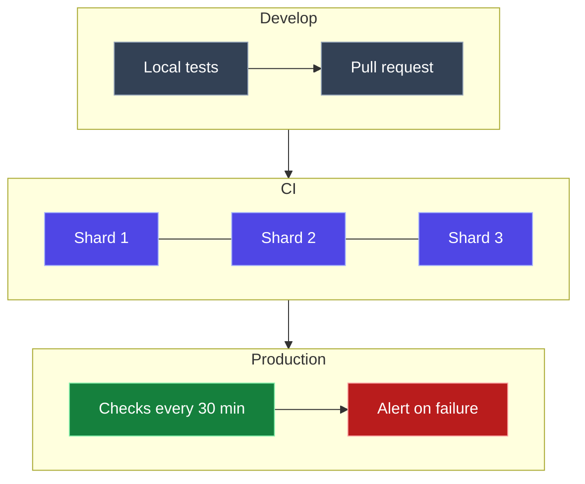

`mcr.microsoft.com/playwright` is Microsoft's official Docker image for [Playwright](https://playwright.dev). It comes with Node.js and three real browsers, **Chromium, Firefox and WebKit** (Safari's engine), plus every system library they need. You don't install anything except Docker.

If I had to sum it up in one sentence: **one `docker run` gives you a working browser lab that behaves the same on every machine.**

<div class="stat-strip">
  <div><b>3</b><span>browsers: Chromium, Firefox, WebKit</span></div>
  <div><b>4</b><span>languages: Node, Python, .NET, Java</span></div>
  <div><b>~1 GB</b><span>download (3.5 GB on disk)</span></div>
  <div><b>0</b><span>things to install besides Docker</span></div>
</div>

All the examples below are in a runnable repo: **[playwright-container-demo](https://github.com/mohiadeen-ameer/playwright-container-demo)**.

## What to use it for

- **End-to-end tests** in Chromium, Firefox and WebKit
- **Visual regression tests** that don't flake between laptops and CI
- **Screenshots and PDFs** of any web page, on demand or on a schedule
- **Synthetic monitoring**: checking your live site the way a user would
- **A shared browser server** that many test suites connect to

## Pick the right tag

```
mcr.microsoft.com/playwright:v1.64.1-noble
```

- **`v1.64.1`** must match the Playwright version in your `package.json`, exactly.
- **`noble`** is the Ubuntu base (`jammy`, `noble` or `resolute`).
- **Other languages:** use `playwright/python`, `playwright/dotnet` or `playwright/java` instead.
- Every tag works on both Intel/AMD and ARM machines, including Apple Silicon Macs.

## Run it right

```bash
docker run --rm --init --ipc=host --user pwuser \
  -v "$PWD":/work -w /work \
  mcr.microsoft.com/playwright:v1.64.1-noble \
  npx playwright test
```

| Flag | Why |
|---|---|
| `--ipc=host` | Prevents Chromium crashes. Docker's default shared memory (64 MB) is too small. |
| `--init` | Cleans up leftover browser processes. |
| `--user pwuser` | Runs as the built-in non-root user instead of root. |
| `-v "$PWD":/work` | Mounts your project, so reports and screenshots land on your disk. |

```quiz
{
  "q": "Your project uses Playwright 1.64.1. Which image tag should you use?",
  "options": ["playwright:latest", "playwright:v1.64.1-noble", "playwright:v1.63.0-noble"],
  "answer": 1,
  "why": "The image's browsers are built for one exact Playwright version. Any other tag and Playwright can't find matching browsers."
}
```

## 1. Run your tests

Mount your project and run the tests. The first run pulls the image; after that it starts in seconds.

```terminal
$ ./test.sh
Running 18 tests using 5 workers
  ✓   1 [chromium] › lists every release with its status (321ms)
  ✓   8 [webkit] › clicking a release opens its details, and × closes them (2.1s)
  ✓  18 [mobile] › details panel looks right (259ms)
  ...
  18 passed (4.8s)
```

That's 18 tests across Chromium, WebKit and a mobile viewport, in under 5 seconds.

### Visual tests that don't flake

Visual tests compare screenshots pixel by pixel. They usually fail for no reason because fonts render differently on a Mac and on a Linux CI server. In the container, **every machine renders the same pixels**, so you can use zero tolerance.

When I shrank one font from 28px to 24px, the functional tests still passed, but the visual tests caught it:

```terminal
  ✘  2 [chromium] › dashboard looks right (light)
    Error: expect(page).toHaveScreenshot(expected) failed
      14607 pixels (ratio 0.02 of all image pixels) are different.
```

<figure><figcaption>Playwright's diff image: every changed pixel in red</figcaption></figure>

> [!TIP]
> Always create and update baselines **inside the container** (`npx playwright test --update-snapshots`), never on your laptop directly.

## 2. Screenshots and PDFs

Any page, any screen size, light or dark mode:

```javascript
const page = await browser.newPage({ viewport: { width: 1440, height: 900 }, colorScheme: "dark" });
await page.goto("https://example.com");
await page.screenshot({ path: "out/home.png", fullPage: true });
await page.pdf({ path: "out/home.pdf" });   // Chromium only
```

The demo's `./shoot.sh` takes 6 screenshots and builds a PDF slide deck from them in under 10 seconds. It's handy before every demo or release.

## 3. Build your own test image

For pipelines, bake your tests into an image built on top of Playwright's:

```dockerfile
FROM mcr.microsoft.com/playwright:v1.64.1-noble
WORKDIR /app
COPY package.json package-lock.json ./
RUN npm ci
COPY . .
RUN chown -R pwuser:pwuser /app
USER pwuser
CMD ["npx", "playwright", "test"]
```

```terminal
$ docker build -t my-tests . && docker run --rm --ipc=host my-tests
  18 passed (4.5s)
```

It only adds about **57 MB** on top of the base image. Because dependencies are installed before the tests are copied, changing a test rebuilds in about **1 second**.

## 4. A shared browser server

Run the browsers in one container and the tests anywhere else. Tests connect over WebSocket. With Docker Compose:

```yaml
services:
  browsers:
    image: mcr.microsoft.com/playwright:v1.64.1-noble
    user: pwuser
    init: true
    ipc: host
    command: ["npx", "-y", "playwright@1.64.1", "run-server", "--port", "3000", "--host", "0.0.0.0"]

  tests:
    build: .
    depends_on: [browsers]
    environment:
      PW_WS: ws://browsers:3000/
```

In `playwright.config.ts`, point the tests at the server:

```typescript
use: {
  connectOptions: { wsEndpoint: process.env.PW_WS, exposeNetwork: "<loopback>" },
},
```

This is useful when several teams or pipelines share one pool of browsers. The [full `compose.yaml`](https://github.com/mohiadeen-ameer/playwright-container-demo/blob/main/compose.yaml) in the repo also adds a health check, so the tests wait until the browsers are ready.

> [!WARNING]
> The server and its clients must run **the same Playwright version**, or the connection fails:
> ```
> 428 Precondition Required
> Playwright version mismatch:
>   - server version: v1.63
>   - client version: v1.64
> ```

## 5. Run it in CI

GitHub Actions can run the whole job inside the image. Split big suites across machines with `--shard`:

```yaml
jobs:
  tests:
    runs-on: ubuntu-latest
    strategy:
      matrix:
        shard: [1, 2, 3]
    container:
      image: mcr.microsoft.com/playwright:v1.64.1-noble
      options: --ipc=host
    steps:
      - uses: actions/checkout@v4
      - run: npm ci
      - run: npx playwright test --shard=${{ matrix.shard }}/3
```

In the demo repo, visual baselines created on my Mac passed on GitHub's Linux servers on the first run, pixel for pixel.

## 6. Monitor production

Run the same image on a schedule against your **live site** to catch broken pages, JavaScript errors and slow loads that a simple uptime check misses:

```yaml
on:
  schedule:
    - cron: "*/30 * * * *"   # every 30 minutes
```

```typescript
test("home page loads fast and lists posts", async ({ page }) => {
  const start = Date.now();
  await page.goto("https://mohiadeen-ameer.github.io/blogs/");
  await expect(page.locator(".card").first()).toBeVisible();
  expect(Date.now() - start).toBeLessThan(5000);
});
```

## How it fits together



Every step uses the same pinned image, so a test that passes on your laptop passes everywhere.

## Checklist

1. Match the image tag to your Playwright version, and upgrade both together.
2. Always run with `--init --ipc=host`, and as `pwuser`.
3. Create visual baselines inside the container.
4. Pin the image by digest in production pipelines.
5. Upload reports and traces from CI so failures are easy to debug.

<details>
<summary>TL;DR</summary>

`mcr.microsoft.com/playwright:v1.64.1-noble` gives you Chromium, Firefox and WebKit with nothing to install but Docker.

- **Use it for:** tests, visual regression, screenshots and PDFs, monitoring, and shared browser servers.
- **Run it with:** `--init --ipc=host --user pwuser`.
- **Keep:** the tag matched to your Playwright version.

</details>

---

*Using Playwright in containers? I'd love to hear how. Find me on [LinkedIn](https://www.linkedin.com/in/mohiadeen-ameer/).*
